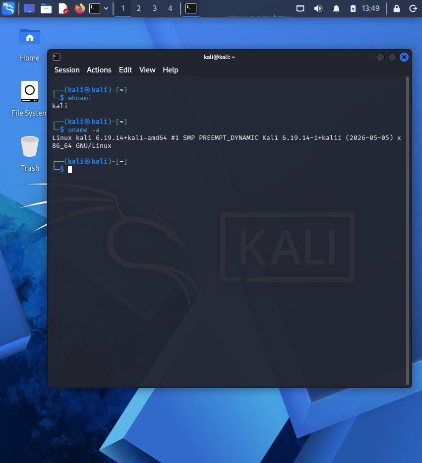

# security-training

I am just starting to learn cybersecurity, and I record my progress in this repository.
I try out what I learn in my own Kali Linux lab and on practice platforms.

## Goal
By May 2027, I will finish the foundations: Linux, networking, Python, web and security basics, with proof for each step in this repository.
After that, I will focus on web and API security, and then on AI security.

